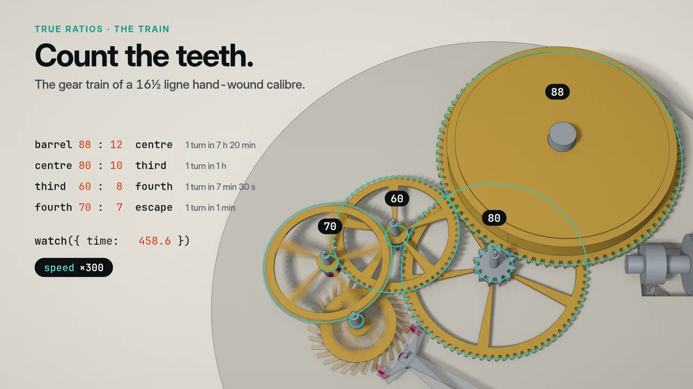

<div align="center">

# brepjs

A CAD library that you install from npm. You write TypeScript, and it gives you exact solids (B-Rep).
AI agents can use it to write parts and check them on OpenCascade.

[](https://www.npmjs.com/package/brepjs)
[](https://github.com/andymai/brepjs/actions/workflows/ci.yml)
[](https://github.com/andymai/brepjs/releases)
[](https://github.com/andymai/brepjs/commits/main)
[](./LICENSE)

https://github.com/user-attachments/assets/66a9308e-b7bf-4407-8718-2949332c67fc

**[▶ Run this engine in your browser](https://brepjs.dev/playground/examples/turbofan-engine)**

<a href="https://brepjs.dev/playground/examples/robot-arm"></a>
<a href="https://brepjs.dev/playground/examples/pocket-watch"></a>

The playground has two more models. A [six-axis robot arm](https://brepjs.dev/playground/examples/robot-arm) moves by a published Denavit-Hartenberg table, and a [pocket-watch movement](https://brepjs.dev/playground/examples/pocket-watch) has the tooth counts of a real calibre.

</div>

This jet engine is one TypeScript file: 237 lines of brepjs that build 1,897 solids. It is a 1:10 display model, not an engineered design. Boolean cuts open the casings, a change to one parameter rebuilds the engine in about half a second, and the result exports to STEP. A coding agent (Claude Code) wrote the file, and `brep verify` checked it.

For a full agent session, [watch an agent design a Raspberry Pi 5 case](https://youtu.be/n8Cbg345NRI) from the official drawing.

Parts are plain TypeScript files, and the checker is a CLI, so any coding agent can use them. These two commands work in an empty folder:

```sh
npx -y -p brepjs-cad brep init bracket                    # writes a starter part
npx -y -p brepjs-cad brep verify bracket/bracket.brep.ts  # builds it on a real kernel and reports
```

To use it in a project, run `npm i -D brepjs brepjs-cad occt-wasm`. Then run `npx brep verify part.brep.ts`. MCP clients and Claude Code have their own setup. See [Authoring CAD with AI](#authoring-cad-with-ai-brepjs-cad).

An agent rebuilt the 46 parts in our example gallery from their descriptions, and all 46 passed `brep verify`. [How we measured it](https://brepjs.dev/agent/eval).

## Or write it yourself

**[▶ Try the live playground](https://brepjs.dev/playground)** · **[Getting Started](./docs/getting-started.md)** · **[Cheat Sheet](./docs/cheat-sheet.md)** · **[Docs](https://brepjs.dev/)**

Shapes are exact mathematical boundaries (not triangle meshes), so booleans are precise, measurements are real, and you can export to STEP. TypeScript types prove that the geometry is valid at compile time.

```typescript
// Drill a hole, fillet the vertical edges, write a STEP file
import { writeFile } from 'node:fs/promises';
import { box, cut, cylinder, fillet, edgeFinder, exportSTEP, unwrap } from 'brepjs/quick';

const b = box(30, 20, 10);
const hole = cylinder(5, 15, { at: [15, 10, -2] });
const drilled = unwrap(cut(b, hole));

const edges = edgeFinder().inDirection('Z').findAll(drilled);
const part = unwrap(fillet(drilled, edges, 1.5));

const step = unwrap(exportSTEP(part));
await writeFile('part.step', await step.text()); // the standard exchange format for CAD tools
```

To see a part while you write it, use the [playground](https://brepjs.dev/playground).

## Why?

brepjs came out of my work on [gridfinitylayouttool.com](https://gridfinitylayouttool.com). I needed parametric CAD in the browser. I am not a 3D modeler, but I know TypeScript. [OpenSCAD](https://openscad.org/) does code-first CAD well, but it is outside the JS ecosystem. [replicad](https://replicad.xyz/) proved that OpenCascade works in JS, but I often hit performance limits and had to fight its API.

Neither one had the type safety that I wanted, so type safety is central to brepjs. It uses branded types, `Result<T,E>`, and phantom types that prove invariants at compile time. If the code compiles, the geometry is valid.

brepjs is strongest at exact geometry that you can manufacture, from a single part to a full assembly. Examples are enclosures, brackets, fixtures, gridfinity bins, and machined and molded parts. It does precise booleans, fillets, chamfers, and shells, and it measures real volumes, areas, and clearances. Its solids are watertight and round-trip through STEP. brepjs is not for organic sculpts or dense lattices. For those, use field-based (implicit/voxel) modeling.

## Install

```bash
npm install brepjs occt-wasm
```

`brepjs` is the API. `occt-wasm` is the geometry kernel that does the math, and it is a separate package so that you can switch to a different kernel. brepjs needs Node.js 24 or later, or a current browser.

To start a new project, run `npm create brepjs my-project`. It makes a TypeScript app with the kernel and the declarative family layer already set up.

`brepjs/quick` initializes the WASM kernel for you with top-level await (ESM only). You can also initialize it in one of these two ways:

```typescript
// Auto-detect kernel
import { init } from 'brepjs';
await init();

// Or manual setup
import { OcctKernel } from 'occt-wasm';
import { registerKernel, OcctWasmAdapter } from 'brepjs';
const kernel = await OcctKernel.init();
registerKernel('occt-wasm', OcctWasmAdapter.fromKernel(kernel));
```

## Usage

Start with the chapter guide:

- **[Why brepjs](https://brepjs.dev/introduction/why-brepjs)**: what makes it different, and who it is for
- **[Install & Initialize](https://brepjs.dev/getting-started/install)**: three init styles, bundler notes
- **[Your First Solid](https://brepjs.dev/getting-started/first-solid)**: the canonical drill-fillet-export workflow
- **[Cheat Sheet](https://brepjs.dev/getting-started/cheat-sheet)**: single-page reference
- **[Core Concepts](https://brepjs.dev/concepts/brep-vs-mesh)**: B-Rep, topology, types, kernels, tolerance
- **[Common Tasks](https://brepjs.dev/tasks/booleans)**: booleans, fillets, sketching, lofts, sweeps, finders, measurement, IO
- **[Declarative Models](https://brepjs.dev/families/overview)**: React-like parametric components (brepjs-families), key-path identity, IFC export
- **[Three.js Integration](https://brepjs.dev/integration/threejs)**: how to mesh shapes and render them
- **[Migration](https://brepjs.dev/migration/replicad)**: how to move from Replicad, OpenSCAD, or Three.js
- **[Extending brepjs](https://brepjs.dev/extending/architecture)**: custom kernels, custom operations, architecture
- **[Reference](https://brepjs.dev/reference/glossary)**: glossary, function lookup, error codes, ADRs
- **[API Reference (TypeDoc)](https://andymai.github.io/brepjs/)**: searchable type-level reference

The older single-page docs stay in [./docs/](./docs/). The chapter site is the canonical location for the docs.

### Architecture

```
Layer 3  sketching/, text/, projection/   High-level API
Layer 2  topology/, operations/, 2d/ ...  Domain logic
Layer 1  core/                            Types, memory, errors
Layer 0  kernel/, utils/                  WASM bindings
```

Imports flow downward only. CI enforces the boundaries.

## Scope

By design, brepjs does not:

- **Render or display geometry**: brepjs makes shape data. To render it, pass the mesh output to Three.js, Babylon.js, or raw WebGL. The separate [`brepjs-viewer`](https://www.npmjs.com/package/brepjs-viewer) package is a React and Three.js renderer for that mesh output.
- **Support organic or sculpting workflows**: brepjs models exact mechanical solids (parts and assemblies). Freeform or organic sculpts and dense lattices are out of scope. Field-based (implicit/voxel) modeling covers them.
- **Make 2D drawings**: 2D profiles are a step toward 3D solids. You can export a profile to DXF (`exportDXF`, `blueprintToDXF`) or to SVG path data (`toSVGPathD`), but brepjs has no dimensions, title blocks, or sheets.
- **Run in server-side rendering (SSR)**: the kernel is WASM and loads asynchronously, so frameworks such as Next.js, Nuxt, and Remix need a client-only import. Node.js scripts and the `brep` CLI work.
- **Provide a GUI**: brepjs is only a programmatic API. It has no visual editor, viewport, or file picker.

## Status

[occt-wasm](https://github.com/andymai/occt-wasm) (OpenCascade compiled to WebAssembly) is the default kernel. [brepkit](https://github.com/andymai/brepkit), a kernel in Rust, is in beta. Because of the kernel abstraction layer, a one-line change switches brepjs to brepkit.

CI runs the full test suite on brepkit too, in the `test-brepkit` job. [`tests/knownFailures/brepkit.json`](./tests/knownFailures/brepkit.json) lists each test that still fails on brepkit, with its brepkit issue. The job fails when a new test fails or when a listed test passes. See [benchmarks](./benchmarks/results/latest.md) for performance comparisons.

## Authoring CAD with AI (brepjs-cad)

[`brepjs-cad`](https://www.npmjs.com/package/brepjs-cad) helps an AI agent (or you) write CAD in brepjs and **prove that it is correct** before handoff. An LLM cannot see geometry. So it writes a `.brep.ts` part, runs it on a real kernel, and reads a deterministic report. It does not guess from how the code reads.

`brepjs-cad` has two parts that work together:

- A **Claude Code skill**, which runs the authoring loop.
- A **CLI** (`brep`), which checks the part: validity, measured dimensions, multi-view snapshots, and STEP export.

Install both. Each part has its own install path:

```bash
# 1. The skill - Claude Code plugin (delivered via this repo's marketplace)
#    In a Claude Code session:
/plugin marketplace add andymai/brepjs
/plugin install brepjs@brepjs
#    …or from a terminal, non-interactively:
claude plugin marketplace add andymai/brepjs
claude plugin install brepjs@brepjs

# 2. The runtime - the CLI the skill drives
npm i -D brepjs-cad
```

After you install the skill, ask Claude for a part in plain English. You can also start the pipeline directly with `/brepjs:cad "a 40×20×10 mm bracket with two M4 holes"`.

`brepjs-cad` bundles its own `brepjs` + `occt-wasm`, so it runs in an empty directory. In a brepjs project, it prefers your installed versions, so the parts that it checks match what you ship. A model is a module. Its default export is a function with no arguments, and that function returns a shape:

```typescript
// bracket.brep.ts
import { box } from 'brepjs';
export const expected = { volume: 8000, tolerancePct: 1 }; // optional: assert intent
export default () => box(40, 20, 10, { centered: true });
```

```bash
npx -y -p brepjs-cad brep verify bracket.brep.ts --check --step bracket.step --json report.json
```

The command exits non-zero unless the report is `ok` (valid **and** every declared dimension within tolerance). Thus you can put it directly into CI or an agent loop. For agents that use MCP, the package also ships a stdio MCP server (`brep-mcp`). It gives the same build-and-check step as a `run_program` tool. See the [**Authoring with AI**](https://brepjs.dev/agent/overview) guide for the full loop, the CLI reference, the MCP server, examples, and the measurement eval.

## Declarative models and BIM (brepjs-families + brepjs-bim)

[`brepjs-families`](https://www.npmjs.com/package/brepjs-families) is a React-like component layer over the CSG IR. Each parametric part is a component: props drive it, you can compose it, and zod checks its props. The IR is content-addressed, so identical subtrees materialize only once. [`brepjs-bim`](https://www.npmjs.com/package/brepjs-bim) projects the same tree to IFC4, with stable GlobalIds that come from the component key paths. The IFC output has walls, slabs, columns, beams, roofs, stairs, and real openings (`IfcOpeningElement` + `IfcRelFillsElement`).

```typescript
const Wall = family('Wall', (p: WallProps) =>
  el('Box', { size: [p.length, p.thickness, p.height], voids: p.voids ?? [] })
);
const wall = Wall({ key: 'south', length: 4000, thickness: 200, height: 2700 });
const tree = resolve(Storey({ key: 'ground', items: [wall] }));
evaluateModel(tree, evaluator); // viewport meshes, one per key path
familiesToBim(tree, { project }); // IFC via brepjs-bim
```

```bash
npm create brepjs my-building   # scaffold a project
npx brepjs add room storey slab # copy in starter families (code you own)
```

See the [**Declarative Models**](https://brepjs.dev/families/overview) guide.

## Projects Using brepjs

- [Gridfinity Layout Tool](https://github.com/andymai/gridfinity-layout-tool): Web-based layout generator for Gridfinity storage systems
- [layerling](https://github.com/henmedia/layerling): Free browser-based 3D CAD for 3D printing

## Get in touch

I am Andy Aragon. I build and maintain brepjs and the geometry kernels below it ([occt-wasm](https://github.com/andymai/occt-wasm), [brepkit](https://github.com/andymai/brepkit)). Do you build something on brepjs and want help, or do you have a question? **[Get in touch →](https://brepjs.dev/support)**

## Contributing

See [CONTRIBUTING.md](./CONTRIBUTING.md) for development setup and guidelines.

## Acknowledgements

[Vercel](https://vercel.com) hosts brepjs.dev and the playground through its Open Source Program.

<div align="center">
  <a href="https://vercel.com/open-source-program">
    
  </a>
</div>

## License

brepjs itself is [Apache-2.0](./LICENSE). The kernel that you register has its own license. A product that you ship must comply with the license of brepjs and the license of that kernel:

| Package                        | License                                                | What it means for your product                                                                                                                                                                       |
| ------------------------------ | ------------------------------------------------------ | ---------------------------------------------------------------------------------------------------------------------------------------------------------------------------------------------------- |
| `brepjs` (this package)        | Apache-2.0                                             | Use freely, open or proprietary                                                                                                                                                                      |
| `occt-wasm` kernel             | LGPL-2.1-only (WASM output; tooling MIT OR Apache-2.0) | Proprietary use permitted under the LGPL's terms                                                                                                                                                     |
| `brepkit-wasm` kernel (3.0.0+) | AGPL-3.0-only or commercial                            | Open-source products use it freely under the AGPL; proprietary products need a [commercial license](https://github.com/andymai/brepkit/blob/main/COMMERCIAL-LICENSE.md) from Collective Context, LLC |

`brepkit-wasm` versions through 2.129.x have the MIT OR Apache-2.0 license, and they stay available under those terms.
